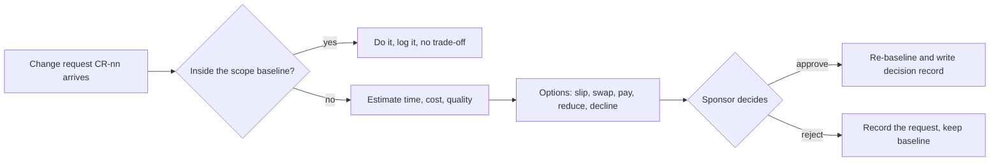

# Change requests · Realtime Quiz · trade-off analysis
Capacity 40 h/week · contingency 56 h · paid capacity 12 USD/h · unallocated cash 85 USD (= 7 TA hours)
Baseline: `features.csv` hours, `moscow.md` classes (Must 300 h = 59.5 %).
Fixed sides (constraints.md): C-01 pilot week 14, C-02 40 h/week, C-03 cash 200 USD.

## CR-02 · Anonymous joining (F15, 12 h) · requested by the student representative
F15 is Could in the baseline. The request promotes it to Should for the pilot.

| Option | Time impact | Cost impact | Quality impact | Fixed side? |
|--------|-------------|-------------|----------------|-------------|
| A absorb: promote F15, pay from contingency | +0 weeks | 12 h; contingency 56 -> 44 h (7.9 % of 560), 0 USD | Contingency below the 10 % policy; risk R-01 (effort overrun) has less cover | ok |
| B swap: promote F15, demote F12 (12 h, Should -> Could) | +0 weeks | 0 h net, 0 USD | FR-N1..N2 notifications leave the pilot; the instructor announces verbally; contingency stays 56 h | ok |
| C pay: TA 12 h | +0 weeks | 12 x 12 = 144 USD | 144 USD against 85 USD unallocated | violates C-03 |
| D decline, F15 stays Could | 0 weeks | 0 h, 0 USD | 50 students register through F06 (FR-A1) before the session, a slower start; O2 (0 blocking defects) unaffected | ok |

**Recommendation:** B. It gives students the join flow they asked for at zero net hours and keeps all 56 h of contingency. A erodes the buffer below 10 % for a Could feature; C breaks the cash cap; D is acceptable but leaves 50 registrations as a pilot-day delay. If CR-03 is approved, B still applies because it is hour-neutral.

## CR-03 · Semester shortened by 2 weeks: pilot in week 12 · dean
Capacity lost: 2 weeks x 40 h = 80 h (560 -> 480 h). Contingency lost: 10 % of 480 = 48 h, so 56 - 48 = 8 h disappear with the weeks.
Planned work 504 h now exceeds capacity 480 h by 24 h before any risk. Keeping the 48 h contingency widens the gap to 504 + 48 - 480 = 72 h.

| Option | Time impact | Cost impact | Quality impact | Fixed side? |
|--------|-------------|-------------|----------------|-------------|
| A drop F14 chat (40 h) + F16 question bank (30 h) + F17 admin (12 h) = 82 h | 0 weeks | -82 h, 0 USD; work 422 h, buffer 480 - 422 = 58 h (12.1 %) | Must 300 h and Should 86 h intact; no chat, no shared question bank; Must is 62.5 % of 480 h, above the 60 % guideline, so risk R-12 is recorded | ok |
| B keep scope, pay TA 72 h | 0 weeks | 72 x 12 = 864 USD | 864 USD is 10 times the 85 USD unallocated and 4.3 times the whole cap | violates C-03 |
| C keep scope, pilot in week 14 | +2 weeks | 0 USD | Ignores the dean's notice; the semester has 12 weeks | violates new C-01 (dean) |

Of the 82 h in option A, 12 h (F17) is already Won't in Task 2, so the real new cut is 70 h against a need of 72 - 12 = 60 h.

**Recommendation:** A. It restores a 58 h buffer, 10 h above the 48 h contingency, and touches no Must or Should feature. B breaks the cash cap; C is the dean's date, not ours to decide.

## Process

