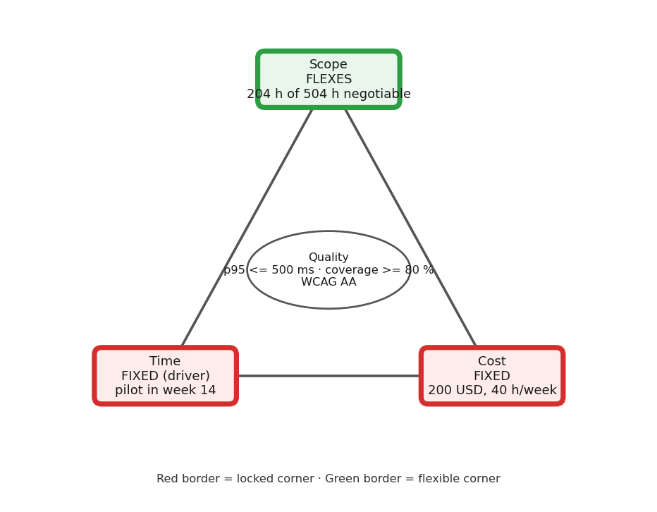

# Constraint analysis · Realtime Quiz · v0.1

Authoritative numbers: Lab-02 recap (4 students x 10 h/week, 504 h planned + 56 h contingency = 560 h).
Charter v1.0 still says 8 h/week and 490 h; see `README.md`, change log.

| Constraint | Fixed or flexes | Evidence (quote, source) | If violated |
|------------|-----------------|--------------------------|-------------|
| Time | **FIXED (driver)** | "the MVP demo is fixed for week 7 and the pilot for week 14" (charter, section 7 Constraints); "Pilot with 50 students in one session, 0 blocking defects, week 14" (charter, O2). The semester has 14 weeks and grades are due at its end. | No pilot in week 14 = no capstone grade and no sponsor decision on adoption |
| Cost | **FIXED** | "hard cap of 200 USD, including hosting, domain, tools and reserve" (charter, section 7). Split: VPS 4 x 25 = 100, domain 15, tools and reserve 85 (recap). | Any overspend has no approver; the PM may only spend the reserve, anything above needs the sponsor in writing within 5 working days |
| Scope | **FLEXES** | features.csv: 5 Should (110 h) + 4 Could (94 h) = 204 h of 504 h (40.5 %) are negotiable; only the 8 Must features (300 h) are required for the pilot. | Should items move to Could or Won't; Must items cannot move without cancelling the pilot |
| Quality | **FIXED (floor)** | "<= 500 ms at the 95th percentile" (charter, O3); "Line coverage >= 80 % and CI green on 100 % of merges" (charter, O5); WCAG AA (NFR table). | The pilot shows lag or defects in front of 50 students; O3 or O5 fails at the week-13 gate |
| Resources | **FIXED** | "4 students x 10 h/week = 40 h/week" (recap, Resources); "no paid staff" (charter, section 7). | Hours above 40 h/week are not available; extra capacity can only be bought, and cash is fixed |
| Risk | **FLEXES (absorbed by contingency)** | Contingency 56 h = 10 % of 560 h (recap, Budget); charter section 8 lists three risks (WebSocket blocked, new Spring versions, Could creep). | A risk that costs more than 56 h forces scope to flex (Should to Won't); a second risk with no buffer left threatens week 7 or week 14 |

## Project shape
Realtime Quiz is a fixed-date, fixed-budget project with a flexible scope. The driver is the week-14 pilot: time gives first and never moves, and the second fixed side is cost (200 USD cash and 40 h/week of effort). Scope flexes and absorbs surprises through the Should and Could classes (204 h, 40.5 % of planned effort), with the 56 h contingency as the first buffer.

## Quality floor (never traded)
1. Broadcast latency is <= 500 ms at the 95th percentile, measured in the week-13 load test and the week-14 pilot (O3).
2. Line coverage is >= 80 % and CI is green on 100 % of merges, checked at the week-7 and week-14 gates (O5).
3. The interface meets WCAG AA and the pilot closes with 0 blocking defects (NFR table, O2).

Red border = locked corner (Time, Cost). Green border = flexible corner (Scope). Quality sits in the centre and is not traded.
