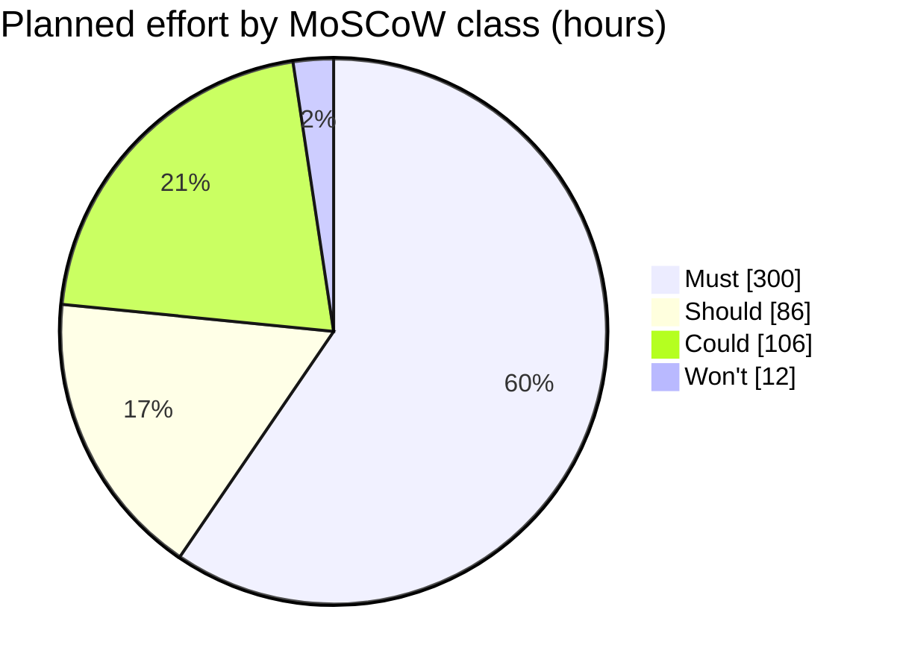

# MoSCoW rating for the week-14 pilot · Realtime Quiz

Test order: Must = pilot cancelled or unlawful without it; Should = painful but a workaround exists for one pilot; Could = nice to have, first to drop; Won't = explicitly not in this pilot.
Hours come from `features.csv` (unchanged). Rated for the pilot release, not the final product.

| Id  | Feature | Plan | Mine | h | Justification |
|-----|---------|------|------|---|---------------|
| F01 | Create quizzes with MCQ | Must | Must | 44 | Must: without authoring there is no quiz to run; the pilot is cancelled. |
| F02 | Students participate in real time | Must | Must | 52 | Must: the 50 pilot students cannot join or answer without it; the pilot is cancelled. |
| F03 | Instant feedback and scoring | Must | Must | 28 | Must: objective O1 requires scoring in the week-7 demo; without it the session has no result. |
| F04 | Leaderboards | Must | Must | 24 | Must: the charter's 8 Must features include it and O1 passes only with 8 of 8 in the MVP demo. |
| F05 | Real-time updates over WebSocket | Must | Must | 48 | Must: O3 (p95 <= 500 ms) cannot be met without WebSocket broadcast; the pilot is cancelled. |
| F06 | Authentication and roles | Must | Must | 44 | Must: storing student names and results without access control is unlawful (C-05). |
| F07 | Timer per question | Must | Must | 28 | Must: questions never close without it, so live scoring fails. |
| F08 | Multiple concurrent sessions | Must | Must | 32 | Must: O4 needs 20 concurrent sessions in the week-13 load test; the readiness gate fails without it. |
| F09 | Responsive design | Should | Should | 20 | Should: pilot students can use laptops or zoom on phones; a workaround exists. |
| F10 | Analytics and reporting | Should | Should | 30 | Should: instructors can read scores from the leaderboard and the database for one pilot. |
| F11 | Export results to CSV and PDF | Should | Should | 24 | Should: instructors can open a CSV in a spreadsheet; PDF is cosmetic for a pilot. Workaround exists. |
| F12 | Real-time notifications | Should | Should | 12 | Should: the instructor announces verbally in the same room; a workaround exists. |
| F13 | Multimedia in questions | Should | **Could** | 24 | Could: pilot quizzes are text-only (to confirm with two instructors, assumption A-07); images can follow in release 1.1. |
| F14 | Chat during sessions | Could | Could | 40 | Could: students and instructor share a room; first to drop and out of the charter's MVP scope. |
| F15 | Anonymous joining with nickname | Could | Could | 12 | Could: pilot students log in with accounts from F06; a slower start, not a blocker. |
| F16 | Question bank shared between quizzes | Could | Could | 30 | Could: instructors can copy questions by hand for one pilot. |
| F17 | Admin role and user management | Could | **Won't** | 12 | Won't: the PM manages the 50 pilot accounts by SQL script; no admin screen needed for one pilot. |

Differences from the plan classes: F13 Should -> Could and F17 Could -> Won't.

## Totals
| Class  | Features | Hours | Share of 504 h |
|--------|----------|-------|----------------|
| Must   | 8 | 300 | 59.5 % |
| Should | 4 | 86  | 17.1 % |
| Could  | 4 | 106 | 21.0 % |
| Won't  | 1 | 12  | 2.4 % |
| **Total** | **17** | **504** | **100.0 %** |

Must share = 300 h / 504 h x 100 = 59.5 %  (guideline: 60 % or less). Inside the guideline, with 1.5 points (about 8 h) of headroom.

Note on the 12 h Won't: F17 is not built, so real planned work is 492 h and 12 h of extra headroom exists. Other files keep the 504 h baseline so numbers match `features.csv`.

